# AttriFy Reproduction: *Let Me Clarify: Interactive Modeling of Soft Attributes*

A from-scratch reproduction of **AttriFy**, the mixed-initiative system from
Holter, Sevastjanova, Benk and El-Assady (arXiv 2610.20227v1, ACM, 2026).
The authors did not publish code, so everything here is built from the paper plus a build
guide (`AttriFy_Build_Guide.pdf`) that contains the paper's prompts verbatim.

> **Honesty box.** What is reproduced, what is my own design, and what is *not* done is spelled out in
> [Section 14](#14-reproduction-status-and-honesty-notes). Read that before quoting any result.

---

## Table of contents

1. [What the paper is about](#1-what-the-paper-is-about)
2. [Languages, stack and glossary](#2-languages-stack-and-glossary)
3. [The core idea in one picture](#3-the-core-idea-in-one-picture)
4. [System architecture](#4-system-architecture)
5. [One turn, step by step (sequence)](#5-one-turn-step-by-step)
6. [The softness algorithm](#6-the-softness-algorithm)
7. [Decision policy and session state machine](#7-decision-policy-and-session-state-machine)
8. [Function Agent and sandbox](#8-function-agent-and-sandbox)
9. [Attribute table and coverage graph](#9-attribute-table-and-coverage-graph)
10. [Code structure, data model and classes](#10-code-structure-data-model-and-classes)
11. [Phase-by-phase production of the paper](#11-phase-by-phase-production-of-the-paper)
12. [Evaluation design (paper) and what is feasible here](#12-evaluation-design)
13. [How to run](#13-how-to-run)
14. [Reproduction status and honesty notes](#14-reproduction-status-and-honesty-notes)
15. [Repository map](#15-repository-map)

---

## 1. What the paper is about

People describe what they want with **soft attributes**: words like "original", "interesting" or "convincing".
A computer cannot score essays on "originality" until someone decides what that means (new ideas? odd style?
unusual structure?). Existing approaches hide the decision inside an opaque embedding space.

The paper's answer has three parts:

1. **Softness.** Define softness as *the extent to which a description admits multiple valid interpretations
   without further specification*, and estimate it computationally. A 62-person formative study supports this.
2. **AttriFy.** Use the softness score as a control signal: when a description is very soft, **ask a
   clarifying question** instead of guessing; when it is precise enough, **generate an executable Python
   function** that scores every text item. Every function is inspectable, so nothing hides in a latent space.
3. **Evaluation.** A 32-person within-subjects study compares AttriFy with a plain LLM-chat baseline.

**Honest headline of the paper itself:** AttriFy did *not* clearly beat the baseline on questionnaire ratings.
It generated fewer functions and fewer, less redundant attributes, and softness went *up* about as often as it went
down during clarification. This reproduction keeps that framing and does not over-claim.

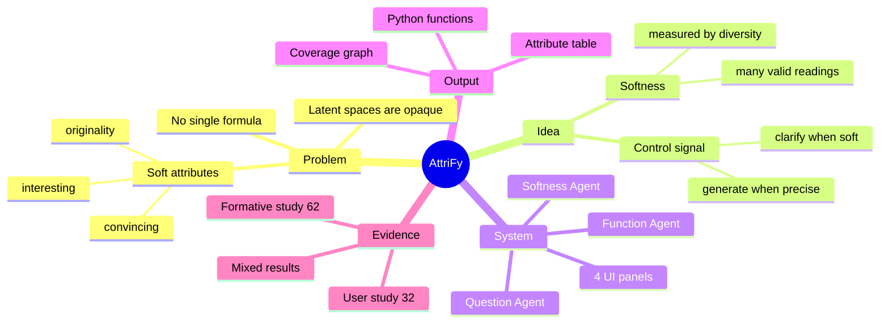

---

## 2. Languages, stack and glossary

### 2.1 Languages used in this repository

| Language | Where | Why |
|---|---|---|
| **Python 3.12** | all of `attrify/*.py` | Agents, softness maths, sandbox, FastAPI server, tests |
| **JavaScript (vanilla, ES2020)** | `attrify/ui.html` | Four-panel single-page UI with inline SVG; no build step, no external scripts |
| **HTML + CSS** | `attrify/ui.html` | Layout, light/dark theme through CSS variables |
| **JSON / JSONL** | `phase*_*.json`, `session_log_*.jsonl` | Registry export, softness results, event logs |
| **Markdown + Mermaid** | this README | Documentation and diagrams |
| **Natural-language prompts** | `attrify/prompts.py` | The paper's prompts (verbatim) plus clearly marked own prompts |

The paper used **React + TypeScript** for the client and **MongoDB** for logs. This reproduction deliberately uses
vanilla JS and JSONL files so it runs with nothing to install beyond Python packages. The logger is a small class
that can be swapped for a database writer.

### 2.2 Libraries

| Purpose | Library |
|---|---|
| LLM calls (OpenAI-compatible endpoints) | `openai` |
| Sentence embeddings | `sentence-transformers` (`all-MiniLM-L6-v2`) |
| Numerics, eigenvalues | `numpy` |
| PCA, DBSCAN, neighbours | `scikit-learn` |
| Data loading | `pandas` |
| Web server | `fastapi`, `uvicorn` |
| Tests | `pytest`, `httpx` (FastAPI `TestClient`) |
| Plot (quick look) | `matplotlib` |

### 2.3 Glossary (defining the language of the paper)

| Term | Plain meaning |
|---|---|
| **Attribute** | A number you can compute for every item, e.g. adjective density of an essay |
| **Soft attribute** | A property such as "originality" with no single formula; many people mean different things |
| **Softness** | How many valid readings a description allows. 1 reading = not soft, many = very soft |
| **Interpretation / reading** | One concrete way to turn a description into a measurable procedure |
| **Preference** | A condition a user places over attributes (out of scope: the paper builds attributes only) |
| **Embedding** | A list of numbers representing a sentence so that similar sentences are close |
| **Cosine similarity** | How alike two embeddings are (1 = same direction, 0 = unrelated) |
| **Vendi score** | An "effective number of distinct items" in a set. 10 paraphrases of one idea gives about 1; 10 unrelated ideas gives about 10 |
| **Mixed initiative** | Both system and user can steer: the system asks, the user can also suggest |
| **Expand / constrain / steer** | The interaction loop: open questions widen readings, clarifications narrow them, suggestions let the user redirect |
| **Approximation gap** | In the history panel, the distance between a node (its softness) and the zero baseline where function cards hang |
| **Attribute table** | Rows = essays, columns = accepted attribute functions |
| **Coverage graph** | 2-D PCA of the attribute table with DBSCAN clusters; large clusters mean essays still look alike |
| **PCA** | Principal Component Analysis: projects many columns down to 2 axes |
| **DBSCAN** | Density-based clustering; points in no dense region are labelled *noise* |
| **CodeAct** | A pattern where an LLM writes and runs Python as its action (paper used `langgraph-codeact`) |
| **AST** | Abstract syntax tree: the parsed structure of code, used to vet code before running it |
| **Rarefaction** | Estimating how many distinct groups you would see in a fixed-size sample (used in the human study) |
| **ICC / ARI / Krippendorff alpha / Spearman rho** | Agreement and correlation statistics used to validate softness against humans |
| **NASA-TLX** | A workload questionnaire (six 0-100 sliders) used in the user study |

---

## 3. The core idea in one picture

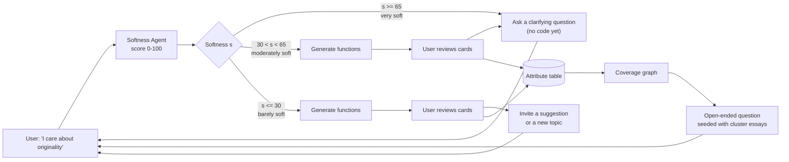

The loop the paper names: **expand** (open-ended questions), **constrain** (clarifications), **steer** (user suggestions).

---

## 4. System architecture

Three agents, four UI panels, one registry and one table.

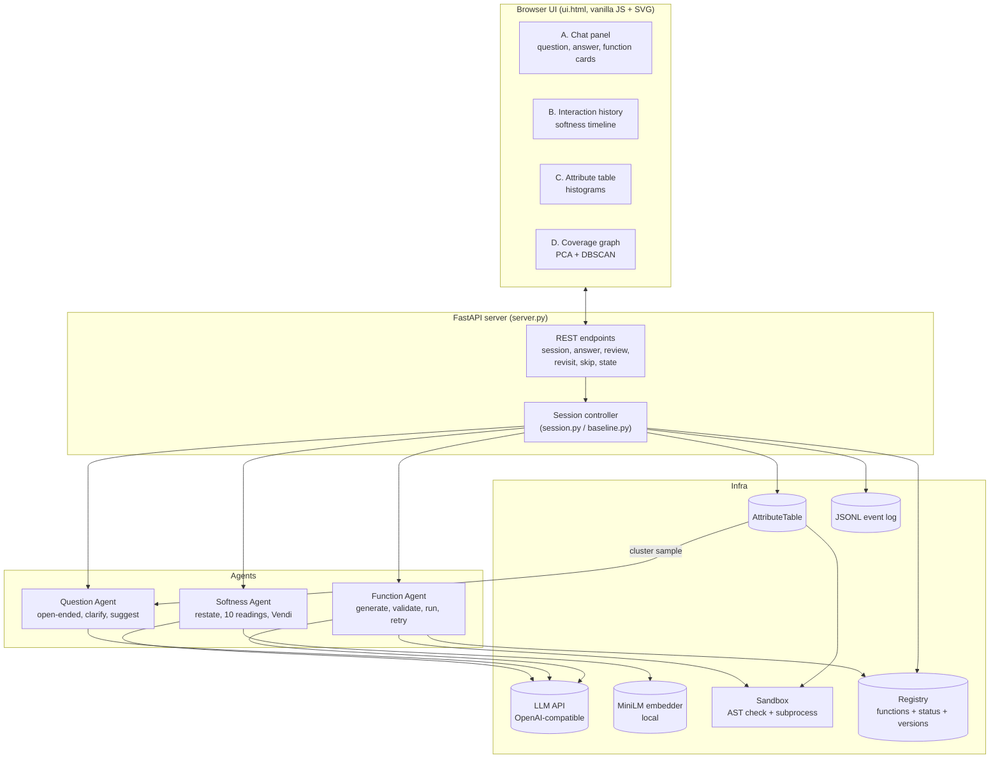

| Agent | Job | Paper's model | Default here |
|---|---|---|---|
| **Softness Agent** | After every user turn: restate the dialogue as one specification, sample 10 readings, embed labels, compute Vendi, map to 0-100 | gemini-3.5-flash (restate, temp 0), gemini-3.5-flash-lite (readings, temp 0.9) | any OpenAI-compatible model; temps 0 and 0.9 kept |
| **Question Agent** | Open-ended, clarifying and suggestion turns | gemini-3.5-flash | configurable; temp 0.7 is my guess |
| **Function Agent** | Turn the current question-answer block into Python attribute functions | CodeAct service | plain generate-validate-run-retry loop |

---

## 5. One turn, step by step

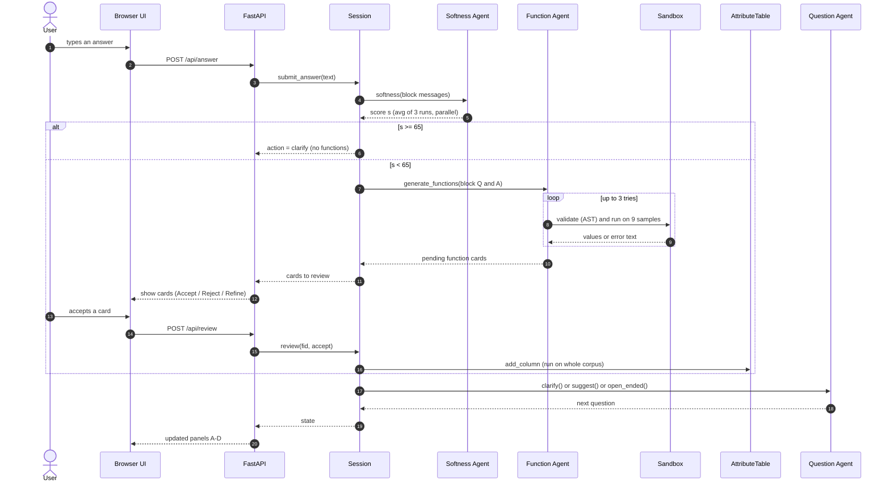

**Blocking rule:** `next_question()` and `submit_answer()` refuse (`ReviewPending`) while any proposed card is still pending.

---

## 6. The softness algorithm

Intuition: ask an LLM for **10 different ways to measure** the description. If the description is soft, it returns ten
genuinely different ideas. If it is precise, the ten answers are near-copies. So *measure how different the ten answers are*.

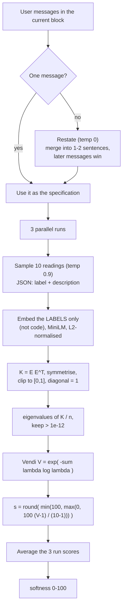

Reference formulas (as implemented in `softness.py`):

```
K        = clip( (E E^T + (E E^T)^T) / 2 , 0, 1 ),  diag(K) = 1
lambda   = eigenvalues( K / n ),  keep lambda > 1e-12
V        = exp( - sum_i lambda_i * log(lambda_i) )
softness = round( min(100, max(0, 100 * (V - 1) / (10 - 1))) )
```

* `V = 1` (all labels identical) gives softness 0. `V = 10` (all orthogonal) gives softness 100. Both are unit-tested.
* The paper's own reliability figure: single-run ICC 0.887, three-run mean 0.959, hence the 3-run average.

---

## 7. Decision policy and session state machine

Calibration from the paper: 65 is roughly where humans rated a description "very soft" (mean 4 or more on the 1-5 scale);
30 is roughly "not soft" (mean about 1). These are **interaction rules**, not a measure of whether a function is correct.

| Softness `s` | Function generation? | Next interaction |
|---|---|---|
| `s >= 65` | No | Clarification question |
| `30 < s < 65` | Yes | User reviews proposals, then clarification question |
| `s <= 30` | Yes | User reviews proposals, then invitation for a suggestion or a new topic |

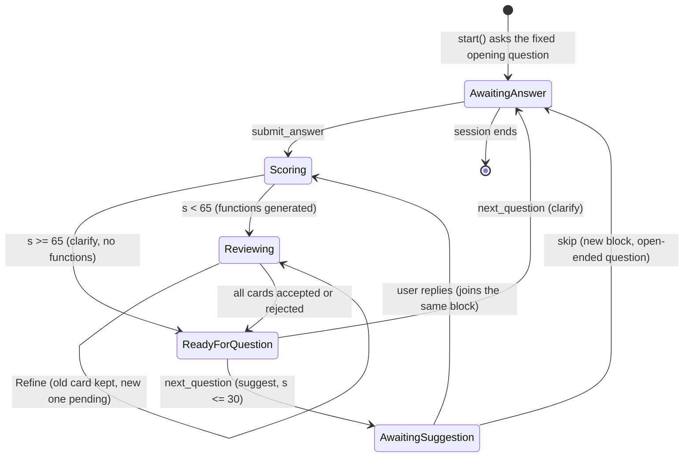

**Blocks.** A block is the run of turns since the last open-ended question. A reply to a suggestion stays in the
current block and the loop restarts from restatement; skipping starts a new block.

**Baseline condition** (for the comparison): plain LLM chat with no softness gate and no phases. It calls the *same*
Function Agent after every user turn and shows the *same* table and graph.

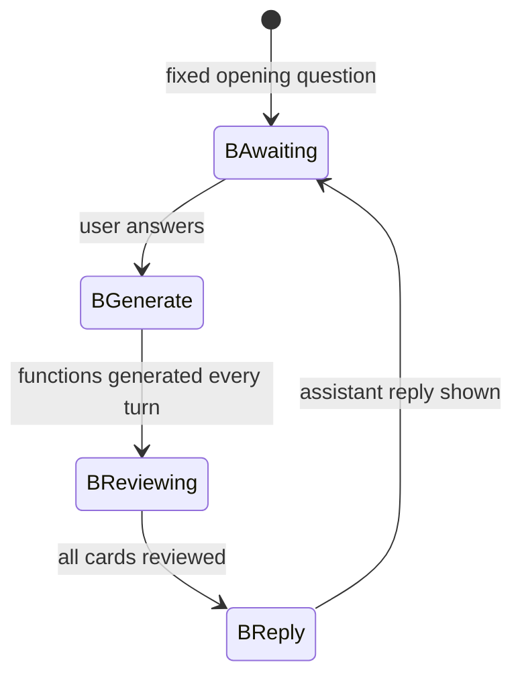

---

## 8. Function Agent and sandbox

The paper publishes **no** Function Agent prompt, only its behaviour: plan, generate, validate (AST), execute in a
resource-limited sandbox on sample text, observe, retry. The prompt here is therefore **my own design**, clearly marked in
`prompts.py`.

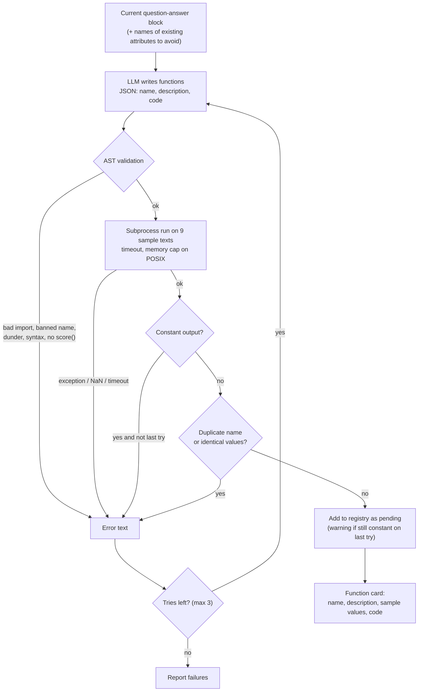

| Guard | What it catches |
|---|---|
| Import allow-list (`re`, `math`, `collections`, `numpy`, `sentence_transformers`; `spacy` if installed) | file / network / process access |
| Banned names (`eval`, `exec`, `open`, `__import__`, `getattr`, ...) and dunder attributes | escape tricks |
| Finite-float check on 9 varied samples (including empty text) | crashes, NaN |
| Constant-output check | functions that return the same value everywhere (found in live testing; the paper reports 38% of functions were zero for over half the essays) |
| Duplicate filter (rejected functions count too) | the same attribute coming back every turn |

> **Limits, stated plainly.** The sandbox is a best-effort guard for LLM-written code on your own machine, **not a security boundary**:
> network is not blocked, and Windows has no memory cap (only the 60 s timeout). Passing every check does **not** prove a function
> matches the user's intent; one live run produced a function that counted the bare word "evidence" right after the user said that
> was not enough.

---

## 9. Attribute table and coverage graph

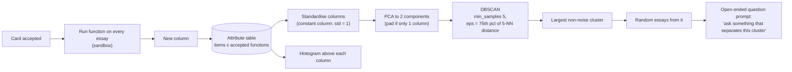

DBSCAN parameters are **not published** in the paper; the values above are my choice and should be tuned on the real corpus.

---

## 10. Code structure, data model and classes

### 10.1 Classes

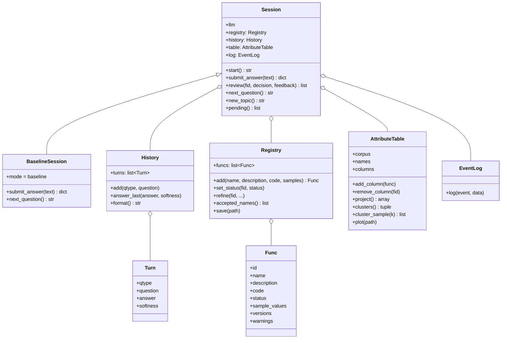

### 10.2 Data model

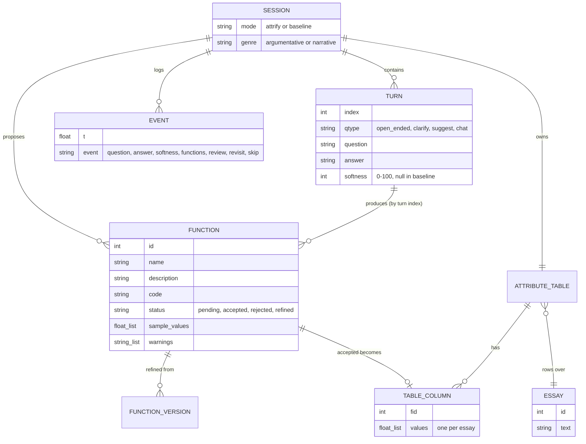

---

## 11. Phase-by-phase production of the paper

The build follows the guide's phases. Estimates are the guide's; the actual build ran as one continuous effort.

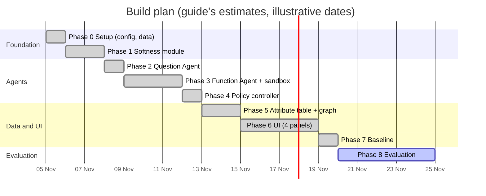

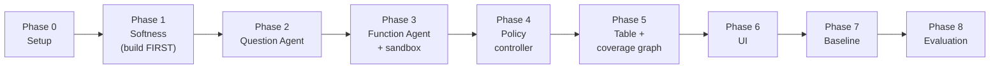

| Phase | What was built | Key files | Verified how |
|---|---|---|---|
| **0 Setup** | Config (models, temperatures, thresholds 65 / 30, retries), corpus loader, synthetic demo corpus | `config.py`, `corpus.py` | Real ASAP 2.0 data **not** present (Kaggle login needed) |
| **1 Softness** | `restate()`, `interpret()`, `vendi()`, `softness()`, Table 2 `policy()`; JSON retry; 3 parallel runs | `softness.py`, `prompts.py`, `run_phase1.py` | Unit tests for the maths; live run on 6 descriptions and 2 dialogues |
| **2 Questions** | Open-ended, clarifying, fixed suggestion text, fixed opening questions, interaction history | `question_agent.py` | Placeholder-fill tests; one live run |
| **3 Function Agent** | Sandbox (AST + subprocess), registry with versions, generate-validate-run-retry loop | `function_agent.py`, `sandbox.py`, `registry.py` | Rejection-rule tests, timeout test, retry tests; live run |
| **4 Policy** | Softness-driven session controller, review blocking, blocks, JSONL event log | `session.py` | Branch, blocking and block-boundary tests; scripted live run |
| **5 Table and graph** | Corpus run on accept, histograms, standardise, PCA, DBSCAN, cluster sampler, quick plot | `attribute_table.py` | Tests on synthetic corpus only |
| **6 UI** | FastAPI server and four-panel SPA; revisit, skip, refine | `server.py`, `ui.html` | 7 API tests; one real turn in a browser, no console errors |
| **7 Baseline** | Plain-chat condition using the same Function Agent every turn | `baseline.py` | 6 tests; one live turn |
| **8 Evaluation** | *Not built yet* (see next section) | | |

Quality fixes found by live testing and applied: parallel softness runs (66 s per answer before), constant-output and
duplicate filtering in the Function Agent (every card was all zeros in the first run), more varied sandbox sample texts,
and API errors no longer being swallowed by the JSON retry loop.

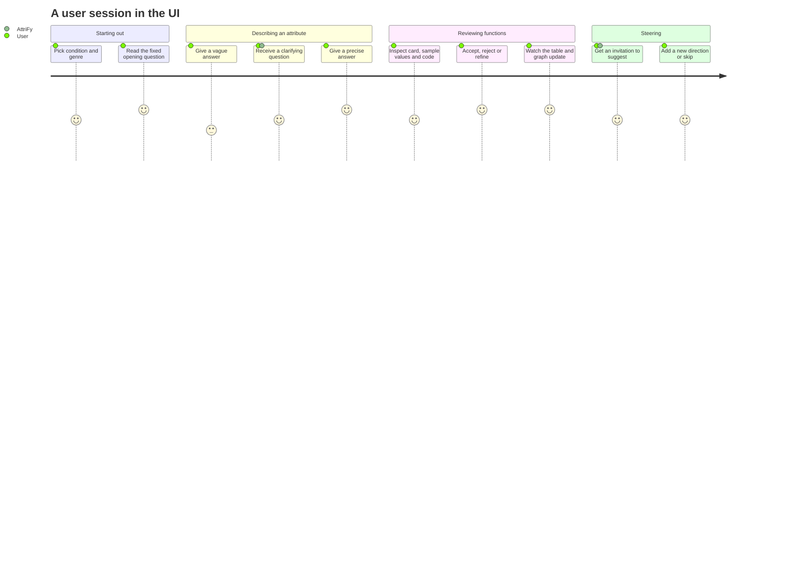

---

## 12. Evaluation design

### 12.1 What the paper did (human studies)

```mermaid
flowchart TD
    subgraph F["Formative study (softness), 62 participants kept of 70"]
        F1["Task 1: write one sentence per description<br/>on how they would measure it (10 descriptions)"]
        F2["Task 2: rate softness 1-5 on 10 descriptions,<br/>rank 8 triplets"]
        F3["Task 3: re-rate softness after each turn<br/>of 5 five-turn dialogues"]
        F1 --> F2 --> F3
        F3 --> FA["Rarefied interpretation counts, ARI, ICC,<br/>Krippendorff alpha, Spearman rho"]
    end
    subgraph U["User study (AttriFy vs baseline), 32 participants kept of 41"]
        U1["Tutorial"] --> U2["Block 1: one tool, 15 min"]
        U2 --> U3["Block 2: the other tool, 15 min"]
        U3 --> U4["10 Likert items + NASA-TLX + preference"]
        U4 --> UA["Wilcoxon signed-rank, Holm-Bonferroni,<br/>process logs, free-text review"]
    end
```

Dialogue types in the formative study: *converging*, *floor*, *plateau*, *re-opening*, *reversal*.
Stimuli: 50 single-attribute descriptions about essays and 20 five-turn dialogues, generated with an LLM and manually filtered.
Dataset: ASAP 2.0 (24,278 student essays, about 500 words), argumentative and narrative subsets.

### 12.2 Numbers to compare against (paper's reported results)

| Measure | AttriFy | Baseline |
|---|---|---|
| Function generation events (mean) | 5.2 | 8.7 (p < .001) |
| Generated attributes (mean) | 8.8 | 11.2 (p = .022) |
| Accepted attributes (mean) | 7.8 | 10.2 (p = .039) |
| Acceptance rate | 88% | 91% |
| Nearest-neighbour embedding similarity of accepted sets | 0.77 | 0.80 |
| NASA-TLX overall | 43.3 | 43.1 (no significant difference) |
| Preference (which tool next) | 12 chose AttriFy, 16 baseline, 4 none | order effect dominates |

Softness validation targets: estimated vs mean human softness rho = **0.742** over 50 descriptions;
within-dialogue correlation rho = **0.642** over 100 turns (0.547 after removing each dialogue's mean).

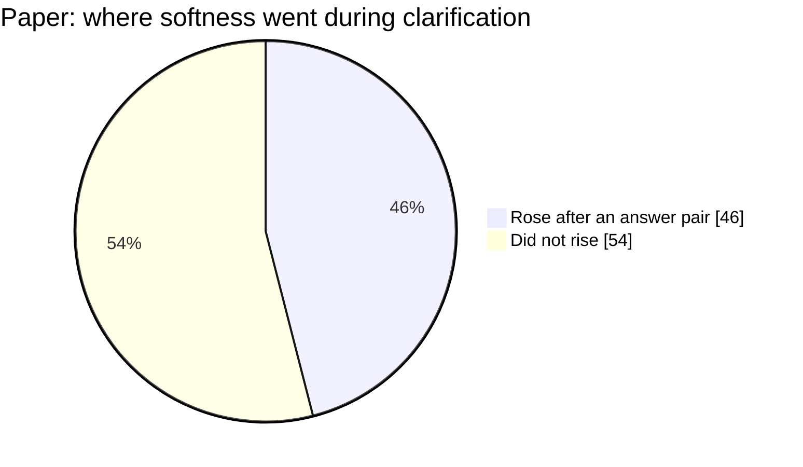

### 12.3 What is feasible in this reproduction

| Piece | Feasible here? | Notes |
|---|---|---|
| Softness maths and the 65 / 30 policy | Yes | Done; validation against human ratings needs human ratings |
| System and baseline conditions | Yes | Done |
| Process metrics (functions generated, accepted, similarity) | Yes, with **simulated users** | An LLM plays a user with a hidden attribute definition; shows process differences, **not** human experience |
| 62-person formative study | No | Needs paid participants; a protocol can be written |
| 32-person user study | No | Same |

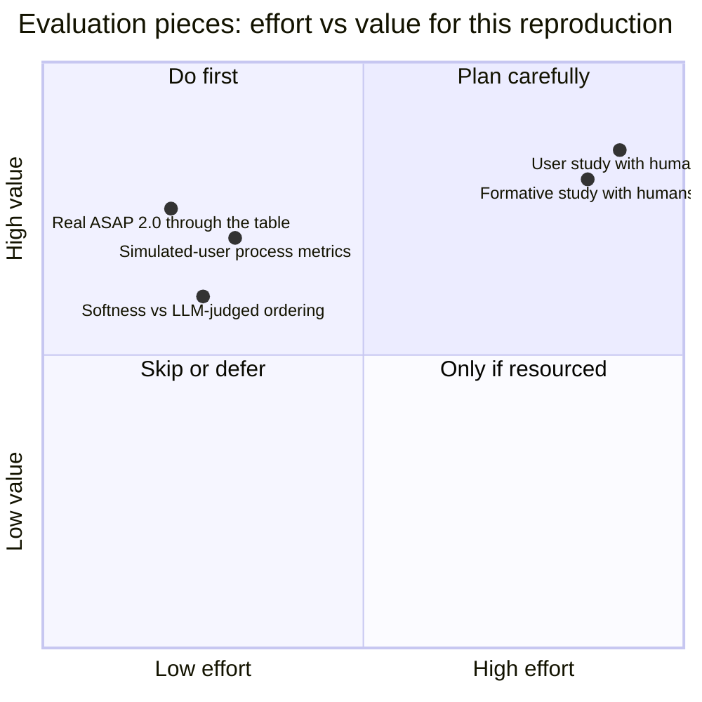

---

## 13. How to run

Install dependencies (Python 3.12 recommended):

```bash
pip install openai numpy scikit-learn pandas sentence-transformers fastapi uvicorn pytest httpx matplotlib
```

Set your own LLM access through **environment variables** (never write keys into files):

| Variable | Meaning |
|---|---|
| `OPENAI_API_KEY` | Key for an OpenAI-compatible endpoint |
| `ATTRIFY_BASE_URL` | Endpoint base URL (omit for OpenAI itself) |
| `ATTRIFY_RESTATE_MODEL`, `ATTRIFY_INTERPRET_MODEL`, `ATTRIFY_QUESTION_MODEL`, `ATTRIFY_FUNCTION_MODEL`, `ATTRIFY_BASELINE_MODEL` | Model names per role |
| `ATTRIFY_CORPUS_CSV`, `ATTRIFY_TEXT_COL`, `ATTRIFY_N` | Real essay corpus (default text column `full_text`, 200 essays); unset = synthetic demo corpus |

Run the offline tests (no API, no model download needed for most):

```bash
cd attrify
python -m pytest tests -q
```

Start the app, then open http://localhost:8000:

```bash
cd attrify
python -m uvicorn server:app --port 8000
```

Live check scripts (they call the LLM): `run_phase1.py`, `run_phase2.py`, `run_phase3.py`, `run_phase4.py`, `run_phase7.py`.

---

## 14. Reproduction status and honesty notes

**Verified (49 offline tests pass):** the Vendi / softness maths, the policy table, JSON retry, question prompt filling,
sandbox rejections and timeout, function retry, constant and duplicate filtering, session blocking and blocks, attribute table
and clustering mechanics, the API flow, and the baseline condition.

**Live-checked once or twice, not exhaustively:** each agent against `gpt-4o-mini` through an OpenAI-compatible endpoint;
one full turn in the browser UI.

**Known weaknesses**

| Area | Issue |
|---|---|
| **Softness validity** | In live runs vague descriptions scored about 74, precise ones 40-59 (expected near 30 or below); a converging dialogue barely dropped (75, 68, 71); the reversal dialogue correctly rose (35 to 78). The paper's rho of 0.742 has **not** been reproduced (no human ratings). I used a different model from the paper, which may be part of the cause |
| **Function correctness** | Validation does not prove a function means what the user meant |
| **Sandbox** | Not a security boundary; no network block; no Windows memory cap |
| **Data** | ASAP 2.0 not present; Phase 5 tested only on a **synthetic** corpus; never report results from it |
| **UI** | Layout and dark theme not visually checked (screenshots failed); revisit / skip / refine only tested through the API |
| **Not in this repo** | Human studies, MongoDB logging, React + TypeScript client, CodeAct service |

**What is the authors' and what is mine**

| From the paper (via the build guide) | My own design (flagged in code) |
|---|---|
| Restatement prompt, 10-readings prompt, open-ended and clarifying prompts, baseline prompt, fixed opening questions, suggestion wording | **Function Agent prompt** and its extra rules (discriminate, no repeats, honour exclusions) |
| Softness algorithm and formulas, 65 / 30 thresholds, MiniLM embedder, 3-run averaging | Question-agent and baseline temperatures, DBSCAN parameters, sample texts, constant / duplicate filters |
| Four-panel interaction design and workflow | Vanilla-JS UI, JSONL logging, review-blocking in the baseline |

**Pitfalls the paper warns about, kept in mind throughout**

* Softness does not always fall during clarification (it rose in 46% of consecutive answer pairs).
* Acceptance is not correctness (38% of functions returned zero for more than half the essays); show sample values before accepting.
* Simple functions hide behind big names (63% used hard-coded word lists, 26% surface statistics); descriptions must say what the code does.
* Over-reliance on AI suggestions; clarification can feel restrictive (let users skip).
* The top softness bands do not separate well in human judgments; do not claim fine-grained precision at the soft end.
* Interpretation boundaries are fuzzy (mean ARI 0.24); treat counts as estimates.
* **Scope:** attributes only, not user preferences over them.

**Security note.** API keys must only ever live in environment variables. If a key was ever pasted into a chat or a file, rotate it.

---

## 15. Repository map

```
RESEARCH_iNTERN_AGENTDEBATE/
├── README.md                    <- this file
├── attrify/                     <- the AttriFy reproduction
│   ├── config.py                models, temperatures, thresholds, retries
│   ├── prompts.py               paper prompts (verbatim) + own Function Agent prompt
│   ├── softness.py              restate, interpret, Vendi, softness, policy
│   ├── question_agent.py        open-ended, clarify, suggest, History / Turn
│   ├── function_agent.py        generate, validate, run, retry, filters
│   ├── sandbox.py               AST allow-list, subprocess runner, sample texts
│   ├── registry.py              Func records, status, versions, warnings
│   ├── session.py               policy controller, blocking, EventLog
│   ├── baseline.py              plain-chat comparison condition
│   ├── corpus.py                CSV loader + synthetic demo corpus
│   ├── attribute_table.py       columns, histograms, PCA, DBSCAN, cluster sampler
│   ├── server.py                FastAPI endpoints
│   ├── ui.html                  four-panel single-page UI
│   ├── run_phase1.py ... run_phase7.py   live check scripts
│   └── tests/                   49 offline tests
├── AAAI2026-MADC/               earlier, separate project (multi-agent debate code)
├── madc_completion/             earlier, separate project
├── company_debate/              earlier, separate project
└── gpt2_embeddings/             earlier, separate project
```

**Source documents:** the paper (`2610.20227v1.pdf`) and the build guide (`AttriFy_Build_Guide.pdf`), both in the Downloads folder.
Citation: Steffen Holter, Rita Sevastjanova, Michaela Benk, Mennatallah El-Assady. *Let Me Clarify: Interactive Modeling of Soft Attributes.* 2026.
